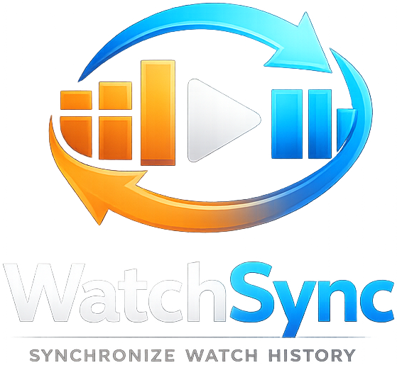

# WatchSync

<!--toc:start-->

- [WatchSync](#watchsync)
  - [Compatibility](#compatibility)
  - [Features](#features)
  - [How copies are matched](#how-copies-are-matched)
    - [Known limitation](#known-limitation)
  - [Installation](#installation)
  - [Configuration](#configuration)
  - [Contributing](#contributing)

<!--toc:end-->

Jellyfin plugin that keeps watch history in sync between copies of the same
media, for example a 1080p library and a 4K library.

Jellyfin stores watch history per item, and an item is tied to its file path:
the 1080p and the 4K copy of the same movie are two items with two separate
histories. WatchSync links them by **identity** (TMDB, IMDb, TVDB ids), never by
path, and copies the watched state, resume position, play count and last played
date between them, in both directions.

## Compatibility

| WatchSync | Jellyfin                             |
| --------- | ------------------------------------ |
| 2.x       | 12.x (built and tested against 12.4) |
| 1.0.0.0   | 10.11 (not maintained)               |

## Features

- **Live sync**: marking an item played or unplayed, finishing (or abandoning)
  playback, or an external tool writing user data (e.g. CrossWatch) updates
  every other copy.
- **Full sync task**: a scheduled task realigns all copies after the fact, for
  example after files were moved and Jellyfin reattached the history to one copy
  only. It merges history without losing any: played if any copy is played,
  highest play count, latest date.
- **Movies and episodes**, in any number of libraries.
- **Configurable**: choice of data to sync, identifiers to use, excluded
  libraries and users.

## How copies are matched

- **Movies** are the same content when they share a **TMDB** or **IMDb** id.
- **Episodes** are the same content when their **series** share a **TVDB** or
  **IMDb** id, and their season and episode numbers are equal.

Two copies are matched only if **at least one id is shared and no id contradicts
another** (same TMDB id but different IMDb ids means one copy is misidentified:
no sync). Movies and episodes are never matched with each other.

**Title + year fallback** (optional, off by default): for movies whose ids
cannot decide (no id present on both copies), match by title, ignoring quality
tags such as "4K" or "1080p", and release year. It never overrides conflicting
ids.

### Known limitation

Libraries using different episode orderings (e.g. TVDB seasons vs AniDB or
absolute numbering, common for anime) number the same episode differently, so
those episodes are not matched. Nothing is synced rather than syncing the wrong
episode.

## Installation

1. In the Jellyfin dashboard, add this plugin repository:
   `https://raw.githubusercontent.com/Atilil/jellytag/main/manifest.json`
2. Install **WatchSync** from the plugin catalog, then restart Jellyfin.

> **Warning:** back up your Jellyfin database before installing. The plugin
> modifies user watch data; a backup lets you restore it if needed.

## Configuration

The settings are on the plugin page in the Jellyfin dashboard:

- **Enable synchronization**: turns live sync and the full sync task on or off.
- **Data to synchronize**: watched status, resume position, play count, last
  played date.
- **Identifiers**: which of IMDB, TMDB and TVDB are used for matching, and the
  title + year fallback.
- **Libraries and users**: exclude some from synchronization.

The full sync task is listed as **WatchSync Full Synchronization** in the
scheduled tasks, where it can be run manually or rescheduled.

## Contributing

See [CONTRIBUTING.md](CONTRIBUTING.md).

---

_This plugin is developed with AI assistance (Claude)._
